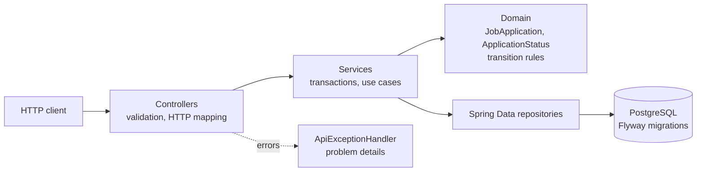

# Job Tracker

[](https://github.com/ric4r2/job-tracker/actions/workflows/ci.yml)


**A REST API for keeping a job search under control:** every application, where it stands, what happened when, and what you need to follow up on today.

I built this because my own job search lived in a spreadsheet that could not answer simple questions like *"who haven't I followed up with?"* or *"what share of my applications actually get a reply?"*.

## Features

- **Track applications**: company, role, location, link, source, notes, dates.
- **Enforced status lifecycle**: an application moves `WISHLIST → APPLIED → INTERVIEWING → OFFER → ACCEPTED`, with `REJECTED`, `WITHDRAWN` and `DECLINED` as exits. Invalid jumps (such as `WISHLIST → OFFER`) are rejected with `409 Conflict`, and the response lists the allowed next steps.
- **Full timeline**: every status change is recorded with a timestamp and an optional note.
- **Follow-up reminders**: set a follow-up date; `GET /api/applications/follow-ups` lists everything due today or earlier.
- **Search, filter, sort and paginate**: by status and by free text across company and role.
- **Stats**: response rate, interview rate and offer rate, with counts per status.
- **Consistent errors**: every error is an [RFC 9457](https://www.rfc-editor.org/rfc/rfc9457) problem detail, with field-level messages for validation errors.

## Tech stack

| Area | Choice |
|---|---|
| Language | Java 25 (records, switch expressions, text blocks) |
| Framework | Spring Boot 4.1 (Web MVC, Data JPA, Validation, Actuator) |
| Database | PostgreSQL 17, schema managed by Flyway; H2 for the zero-setup `local` profile |
| Testing | JUnit 5, AssertJ, Mockito, MockMvc, Testcontainers |
| Build and delivery | Maven Wrapper, multi-stage Docker image, Docker Compose, GitHub Actions |

## Architecture



The code is organized **by feature** (`jobapplication`, `stats`, `common`) rather than by layer, so everything about one concept lives together.

**Design decisions**

- **Rules live in the domain.** `ApplicationStatus` owns the transition table and `JobApplication.changeStatus(...)` enforces it. The service only coordinates, so the rules can be unit-tested without Spring or a database.
- **Status is not editable through `PUT`.** It changes only through `POST /{id}/status`, which guarantees every change is validated and appears in the history.
- **Flyway owns the schema.** Hibernate runs in `validate` mode, so any mismatch between entities and migrations fails at startup and in tests rather than in production.
- **An injected `Clock`.** Dates such as "applied today" come from a `Clock` bean, which makes them deterministic in tests.
- **Optimistic locking** (`@Version`). Two concurrent edits cannot silently overwrite each other; the second one gets `409`.
- **Stats use the history, not just the current status.** An application that was interviewed and later rejected still counts toward the interview rate.

## Getting started

You need **JDK 25**. Maven is not required, because the project ships with the Maven Wrapper.

### Option 1: quick try, nothing else to install

Runs with an in-memory H2 database and a few demo applications:

```bash
./mvnw spring-boot:run -Dspring-boot.run.profiles=local
```

On Windows use `mvnw.cmd` instead of `./mvnw`. Then open <http://localhost:8080/api/applications>. The H2 console is at <http://localhost:8080/h2-console> (JDBC URL `jdbc:h2:mem:jobtracker`, user `sa`, no password).

### Option 2: with PostgreSQL in Docker

```bash
docker compose up --build
```

This starts PostgreSQL and the app on <http://localhost:8080>. To run the app from your IDE against the same database, start only the database with `docker compose up db`.

## API

| Method | Path | Description |
|---|---|---|
| `GET` | `/api/applications` | List. Query params: `status`, `q`, `page`, `size`, `sort` (default `updatedAt,desc`) |
| `POST` | `/api/applications` | Create. Returns `201` and a `Location` header |
| `GET` | `/api/applications/{id}` | Get one |
| `PUT` | `/api/applications/{id}` | Update details (not the status) |
| `POST` | `/api/applications/{id}/status` | Change status: `{"status": "APPLIED", "note": "...", "nextFollowUpOn": "2026-12-01"}` |
| `GET` | `/api/applications/{id}/history` | Status timeline |
| `DELETE` | `/api/applications/{id}` | Delete, along with its history |
| `GET` | `/api/applications/follow-ups` | Active applications with a follow-up due today or earlier |
| `GET` | `/api/stats` | Counts and rates |
| `GET` | `/actuator/health` | Health check |

Ready-to-run examples are in [`requests.http`](requests.http) (IntelliJ IDEA or the VS Code REST Client extension). With curl:

```bash
curl -X POST localhost:8080/api/applications -H "Content-Type: application/json" -d '{"company":"Example Corp","role":"Junior Java Developer","status":"APPLIED"}'
```

An invalid status change returns:

```json
{
  "title": "Status change not allowed",
  "status": 409,
  "detail": "Application 3 cannot move from WISHLIST to OFFER",
  "instance": "/api/applications/3/status",
  "currentStatus": "WISHLIST",
  "requestedStatus": "OFFER",
  "allowedNextStatuses": ["APPLIED", "WITHDRAWN"]
}
```

## Testing

```bash
./mvnw verify
```

| Test | What it covers |
|---|---|
| `ApplicationStatusTest`, `JobApplicationTest` | Transition rules and entity behaviour (plain unit tests) |
| `JobApplicationServiceTest` | Use cases with mocked repositories and a fixed clock |
| `JobApplicationControllerTest` | HTTP layer: status codes, validation, problem-detail format |
| `JobApplicationRepositoryTest` | Real Flyway migrations, schema validation, search and stats queries |
| `LocalProfileSmokeTest` | The `local` profile starts with its demo data |
| `JobApplicationApiIntegrationTest` | The full lifecycle against real PostgreSQL via Testcontainers |

The Testcontainers test needs Docker. It is skipped automatically when Docker is not running, and it always runs in [CI](.github/workflows/ci.yml).

## Roadmap

- [x] REST API, status lifecycle, history, follow-ups, stats
- [x] Flyway, Testcontainers, Docker, GitHub Actions
- [ ] User accounts and authentication (Spring Security + JWT), with each user seeing only their own data
- [ ] OpenAPI / Swagger UI documentation
- [ ] Web frontend
- [ ] Email reminders for due follow-ups
- [ ] Public deployment

## License

[MIT](LICENSE)
